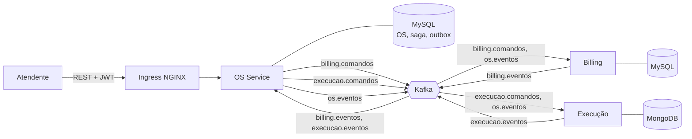
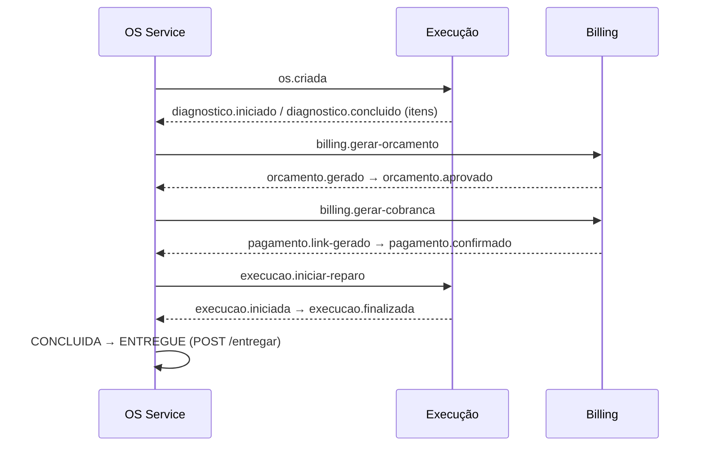
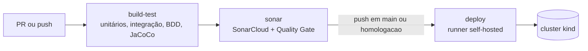

# AutoCenter FIAP — OS Service (Ordem de Serviço)

[](https://github.com/AutocenterFiap/autocenter-os-service/actions/workflows/ci-cd.yml)
[](https://sonarcloud.io/summary/new_code?id=AutocenterFiap_autocenter-os-service)
[](https://sonarcloud.io/summary/new_code?id=AutocenterFiap_autocenter-os-service)

Microsserviço de **Ordem de Serviço** do AutoCenter FIAP (Tech Challenge SOAT, Fase 4). Abre a OS, guarda seu status e
histórico e é o **orquestrador da Saga**: decide cada passo do fluxo e comanda o Billing e a Execução pelo Kafka.

## Ecossistema

| Repositório | Responsabilidade | Banco |
|---|---|---|
| **autocenter-os-service** (este) | Abertura, status e histórico da OS; orquestração da Saga | MySQL 8 |
| [autocenter-billing-service](https://github.com/AutocenterFiap/autocenter-billing-service) | Orçamento, cobrança e pagamento (Mercado Pago) | MySQL 8 |
| [auto-center-execucao](https://github.com/AutocenterFiap/auto-center-execucao) | Fila da oficina, diagnóstico e reparo | MongoDB |
| [autocenter-k8s-infra](https://github.com/AutocenterFiap/autocenter-k8s-infra) | Clusters kind, Kafka, Ingress e Kafka UI | — |

Nenhum serviço acessa o banco de outro: toda a integração passa pelo Kafka.

## Responsabilidades

- Abrir a OS (`POST /v1/ordem-servicos`) e publicar `os.criada`.
- Manter o status da OS e o histórico de cada transição.
- Conduzir a Saga: enviar comandos ao Billing e à Execução e reagir aos eventos de resultado.
- Disparar as compensações (estorno, cancelamento) quando uma etapa falha.

## Saga Pattern: por que orquestrada

O fluxo tem muitos passos, compensações (estorno) e prazo de pagamento. Com um ponto central decidindo o próximo passo:

- o estado de cada OS fica visível em um só lugar (tabela `saga_os`), o que facilita rastrear e demonstrar falhas;
- Billing e Execução não se conhecem: cada um executa um comando e publica o resultado;
- as regras de compensação ficam juntas, em uma máquina de estados testável
  (`domain/saga/MaquinaEstadosSaga.java`).

O custo é concentrar as regras do fluxo no OS Service. Na coreografia, cada serviço reagiria aos eventos dos outros e o
fluxo ficaria espalhado, mais difícil de seguir e de compensar.



### Fluxo principal



### Compensações

| Falha | Reação do orquestrador |
|---|---|
| Diagnóstico sem itens ou `orcamento.falhou` | Cancela a OS (`os.cancelada`) |
| `orcamento.reprovado` | Encerra a OS em `ORCAMENTO_REPROVADO`, sem reparo |
| Pagamento recusado | Gera nova cobrança; na 3ª recusa, cancela |
| Link de pagamento vencido | Agendador (a cada 30 s) cancela a OS |
| `execucao.falhou` após o pagamento | `AGUARDANDO_ESTORNO` → `billing.estornar-pagamento` → `CANCELADA` após `pagamento.estornado` |
| Pagamento confirmado em OS já cancelada | Mantém a OS e manda estornar |
| `pagamento.estorno-falhou` | Mantém em `AGUARDANDO_ESTORNO`; `POST /{id}/reprocessar-estorno` reenvia |

Estados, diagrama de transições, outbox, idempotência e limites aceitos estão em
[`docs/arquitetura.md`](docs/arquitetura.md).

## Arquitetura do serviço

Arquitetura hexagonal; o domínio não depende de Spring.

```
domain/          OS, itens, máquina de estados da Saga
application/     casos de uso e portas
adapter/         REST e consumidores Kafka
infrastructure/  JPA/MySQL, outbox, segurança (JWT), configuração
```

**Confiabilidade**

- **Outbox transacional:** a mudança de status e a mensagem de saída são gravadas na mesma transação (tabela `outbox`).
- **Consumidor idempotente:** o `eventId` de cada mensagem é gravado em `mensagem_processada`; repetições são ignoradas.
- **Ordem por OS:** a chave Kafka é o `osId`.
- **DLT:** erro técnico tem 3 retentativas (1 s, 2 s, 4 s) e depois vai para `<tópico>.dlt`; mensagem malformada vai
  direto para a DLT.

**Stack:** Java 21, Spring Boot 3.3.4, Spring Data JPA + Flyway, Spring for Apache Kafka, Spring Security (JWT HS256),
springdoc-openapi, Micrometer/Prometheus, JUnit 5, Testcontainers, Cucumber, JaCoCo.

## Contrato de mensagens

Envelope comum a todos os serviços (chave Kafka = `osId`):

```json
{ "eventId": "uuid", "tipo": "os.criada", "versao": 1, "osId": 123,
  "correlationId": "uuid", "ocorridoEm": "2026-01-01T00:00:00Z", "payload": {} }
```

| Direção | Tópico | Tipos |
|---|---|---|
| Publica | `os.eventos` | `os.criada`, `os.cancelada`, `os.concluida`, `os.entregue` |
| Publica | `billing.comandos` | `billing.gerar-orcamento`, `billing.gerar-cobranca`, `billing.estornar-pagamento` |
| Publica | `execucao.comandos` | `execucao.iniciar-reparo` |
| Consome | `billing.eventos` | `orcamento.*`, `pagamento.*` |
| Consome | `execucao.eventos` | `diagnostico.*`, `execucao.*` |

Há um JSON de exemplo por tipo em [`docs/contratos/exemplos/`](docs/contratos/exemplos) e um simulador de eventos
(`scripts/publicar-evento.sh`) descrito em [`docs/contratos/README.md`](docs/contratos/README.md).

Em `diagnostico.concluido`, "sem itens" significa **listas vazias** (`{ "itens": { "servicos": [], "produtos": [] } }`),
o que cancela a OS. Um `{ "itens": {} }` é mensagem inválida e vai para a DLT.

## API REST

Todas as rotas exigem `Authorization: Bearer <jwt>` (HS256, issuer `Auto Center Fiap`). Para gerar um token de teste:
`scripts/gerar-token.sh`.

| Método | Rota | Descrição |
|---|---|---|
| `POST` | `/v1/ordem-servicos` | Abre a OS e inicia a Saga |
| `GET` | `/v1/ordem-servicos` | Lista as OS |
| `GET` | `/v1/ordem-servicos/{id}` | Detalha a OS |
| `GET` | `/v1/ordem-servicos/numero/{numero}` | Busca pelo número |
| `GET` | `/v1/ordem-servicos/status/{id}` | Status atual |
| `GET` | `/v1/ordem-servicos/{id}/historico` | Histórico de transições |
| `POST` | `/v1/ordem-servicos/{id}/entregar` | Entrega a OS concluída |
| `POST` | `/v1/ordem-servicos/{id}/cancelar` | Cancela antes de `EM_EXECUCAO` |
| `POST` | `/v1/ordem-servicos/{id}/reprocessar-estorno` | Reenvia o comando de estorno |

**Swagger:** `http://localhost:8098/swagger-ui/index.html` (OpenAPI em `/v3/api-docs`, público). No cluster, o Ingress
expõe só `/v1/ordem-servicos`; para o Swagger, use port-forward:

```bash
kubectl --context kind-autocenter -n autocenter port-forward svc/os-service 8098:8098
```

## Como executar

**Pré-requisitos:** JDK 21, Maven 3.9+, Docker. Para o cluster: `kind` e `kubectl`.

O segredo do JWT (`SISTEMA_SEGURANCA_CHAVE_SECRETA`) não tem valor padrão; sem ele o serviço não sobe:

```bash
export SISTEMA_SEGURANCA_CHAVE_SECRETA="$(openssl rand -hex 32)"
```

**Local (MySQL e Kafka no docker-compose):**

```bash
docker compose -f docker/docker-compose.yml up -d mysql kafka kafka-topicos
mvn spring-boot:run          # http://localhost:8098
```

Para subir tudo em containers, inclusive o serviço: `docker compose -f docker/docker-compose.yml up -d --build`.

**No cluster kind** (criado pelo [autocenter-k8s-infra](https://github.com/AutocenterFiap/autocenter-k8s-infra)). Use
sempre `--context` explícito. O Secret `os-service-secrets` é criado uma vez por cluster
([`docs/contratos/README.md`](docs/contratos/README.md)):

```bash
docker build -f docker/Dockerfile -t os-service:local .
kind load docker-image os-service:local --name autocenter
kubectl --context kind-autocenter apply -k k8s
kubectl --context kind-autocenter -n autocenter rollout status deploy/os-service --timeout=180s
```

## Testes e cobertura

```bash
mvn -B verify    # unitários + integração + BDD; requer Docker (Testcontainers: MySQL e Kafka)
```

- **Unitários** (Surefire): domínio, máquina de estados, casos de uso, controllers e consumidores.
- **Integração** (Failsafe): Testcontainers com MySQL e Kafka reais.
- **BDD** (Cucumber, [`saga.feature`](src/test/resources/features/saga.feature)): 7 cenários da Saga, entre eles fluxo
  completo até a entrega, três recusas de pagamento, link expirado, orçamento reprovado, falha na execução com estorno
  e pagamento atrasado.
- **Gate:** o build falha com menos de 80% de cobertura de linhas (JaCoCo).

**Evidência** (`mvn -B verify`, 16/11/2026, BUILD SUCCESS):

| Métrica | Cobertas / total | % |
|---|---|---|
| Linhas | 816 / 829 | 98,4 |
| Branches | 268 / 285 | 94,0 |
| Instruções | 4297 / 4354 | 98,7 |
| Métodos | 240 / 243 | 98,8 |

Testes: 262, todos passando (207 unitários e 55 de integração e BDD). Fora da medição: `OsServiceApplication`, DTOs e
entidades JPA. Relatório HTML em `target/site/jacoco/index.html`, publicado como artefato `jacoco` em cada
execução do pipeline. Análise contínua no [SonarCloud](https://sonarcloud.io/summary/new_code?id=AutocenterFiap_autocenter-os-service).

<!-- TODO: adicionar print do SonarCloud em docs/img/sonar.png -->

## CI/CD

Pipeline único em [`.github/workflows/ci-cd.yml`](.github/workflows/ci-cd.yml):



O job `deploy` roda `scripts/deploy-kind.sh <cluster> <sha>`: build da imagem com a tag do commit, `kind load`,
`kubectl apply -k` e espera do rollout.

| Branch | Cluster kind | GitHub Environment |
|---|---|---|
| `main` | `autocenter` | `producao` |
| `homologacao` | `autocenter-qa` | `homologacao` |

**Fluxo de branches:** `feat/*` → PR para `homologacao` → PR para `main`. As duas branches são protegidas: merge só por
PR, com os checks `build-test` e `sonar` passando.

## Observabilidade

- `/actuator/health` (liveness e readiness) e `/actuator/prometheus`, públicos para as probes.
- Logs em JSON (`logback-spring.xml`) com `correlationId` no MDC, propagado no envelope de cada mensagem.
- Métricas de negócio no Prometheus: `autocenter.os.criada.total`, `autocenter.os.status.total`,
  `autocenter.saga.compensada.total`, `autocenter.saga.estorno_falhou.total`, `autocenter.saga.evento_descartado.total`
  e `autocenter.saga.mensagem_dlt.total`.
- Tracer Datadog (`dd-java-agent`) embutido na imagem, com anotações de autodiscovery no Deployment; o agente é
  instalado pelo [autocenter-k8s-infra](https://github.com/AutocenterFiap/autocenter-k8s-infra#datadog).
- Os dashboards do Datadog estão versionados em [`/docs`](./docs/), contendo arquivos `.json` importáveis diretamente na plataforma Datadog.

## Limitações conhecidas

- **Uma réplica** com `strategy: Recreate`: o relay do outbox não foi desenhado para várias instâncias.
- **DLT sem reprocessamento automático:** a mensagem é reenviada manualmente (Kafka UI ou CLI).
- **Dependência síncrona do Cadastro:** abrir OS consulta o [Cadastro Service](https://github.com/AutocenterFiap/autocenter-cadastro-service)
  por REST (`GET /v1/clientes/{id}` e `GET /v1/veiculos/{id}`, com o JWT da requisição repassado). Cliente que não
  existe ou não está `ATIVO`, ou veículo inexistente, dá 404. Cadastro fora do ar ou com erro dá 503, e a OS não é
  criada. Para rodar local sem o Cadastro: `CADASTRO_MODO=stub` (aceita qualquer ID).

## Equipe

<!-- TODO: completar nomes e RMs -->

| Nome | RM | Responsabilidade |
|---|---|---|
| Felipe | RM | OS Service e infraestrutura |
| Willian | RM | Billing Service |
| Matheus | RM | Execução |
