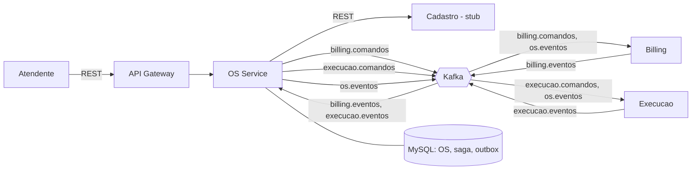

# AutoCenter - OS Service

Microsservico de Ordem de Servico do AutoCenter (FIAP Tech Challenge, Fase 4). Ele e o **orquestrador da Saga** que
conduz a OS da abertura a entrega, comandando o Billing e a Execucao por Kafka.

Equipe: **Felipe** (OS Service), **Willian** (Billing), **Matheus** (Execucao).

## Por que Saga orquestrada

O fluxo tem muitos passos, compensacoes (estorno) e prazo de pagamento. Com um ponto central decidindo o proximo passo,
o estado de cada OS fica visivel num so lugar, o que facilita rastrear e demonstrar as falhas. Os participantes executam
um comando e publicam o resultado, sem reagir aos eventos uns dos outros. O custo e o acoplamento das regras do fluxo ao
OS Service. Detalhes em [`docs/arquitetura.md`](docs/arquitetura.md).



## Como rodar

**Testes:** `mvn -B verify` (precisa de Docker: Testcontainers sobe MySQL e Kafka).

**Local com docker-compose.** `SISTEMA_SEGURANCA_CHAVE_SECRETA` (segredo HS256 do JWT) nao tem valor padrao: sem ela, o
compose recusa subir e o servico nao inicia. Um valor aleatorio basta para testar; para aceitar tokens reais do monolito
ele precisa ser o mesmo segredo (ver [`docs/contratos/README.md`](docs/contratos/README.md)).
```bash
export SISTEMA_SEGURANCA_CHAVE_SECRETA="$(openssl rand -hex 32)"
```
Com o servico pelo Maven (so MySQL e Kafka no compose):
```bash
docker compose -f docker/docker-compose.yml up -d mysql kafka kafka-topicos
mvn spring-boot:run          # porta 8098; perfil demo: -Dspring-boot.run.profiles=demo (link expira em 2 min)
```
Ou tudo em containers, inclusive o servico (imagem com perfil `prod`, logs em JSON, tambem na porta 8098):
```bash
docker compose -f docker/docker-compose.yml up -d --build
```

**No cluster kind** (infra em `autocenter-k8s-infra`: `./scripts/criar-cluster.sh`). Todo comando usa
`--context kind-autocenter`, porque o contexto padrao desta maquina e um EKS real. Passo a passo completo (Secret,
banco, imagem, apply, simulador de eventos) em [`docs/contratos/README.md`](docs/contratos/README.md):
```bash
./scripts/criar-banco.sh     # uma vez: MySQL proprio em k8s/banco, volume com Retain
docker build -f docker/Dockerfile -t os-service:local .
kind load docker-image os-service:local --name autocenter
kubectl --context kind-autocenter apply -k k8s/app
kubectl --context kind-autocenter -n autocenter rollout status deploy/os-service --timeout=180s
```
O banco (`k8s/banco`) e a aplicacao (`k8s/app`) tem ciclos de vida separados: o deploy do pipeline aplica so
`k8s/app`, entao nunca reinicia, recria nem apaga o MySQL.

## Swagger

No cluster, o Ingress expoe a API (`/v1/ordem-servicos`), o Swagger (`/swagger-ui`) e o OpenAPI (`/v3/api-docs`), tanto
em `localhost` quanto pelo IP da maquina na rede (o Ingress escuta em `0.0.0.0:80`). O actuator fica fora do Ingress.
Swagger e OpenAPI sao publicos, sem token:
```
http://localhost/swagger-ui/index.html        (OpenAPI em http://localhost/v3/api-docs)
```
Para chamar as rotas pelo "Authorize" do Swagger, gere um token com `scripts/gerar-token.sh`. O "Try it out" usa o
mesmo endereco pelo qual o Swagger foi aberto. Rodando local (`mvn spring-boot:run`), o Swagger fica em
`http://localhost:8098/swagger-ui/index.html`.

Cada endpoint, parametro, resposta e campo tem descricao; `OpenApiDocumentacaoIT` falha se algo novo ficar sem
documentacao.

## Evidencias de cobertura

Resultado de `mvn -B verify` (BUILD SUCCESS, gate de 80% de linhas do JaCoCo atendido), medido em
`target/site/jacoco/jacoco.xml`, com unitarios, integracao e BDD no mesmo relatorio:

| Metrica | Cobertas / total | % |
|---|---|---|
| Linhas | 836 / 849 | 98,5 |
| Instrucoes | 4382 / 4439 | 98,7 |
| Branches | 278 / 295 | 94,2 |
| Metodos | 245 / 248 | 98,8 |

Testes: 209 unitarios (Surefire) e 58 de integracao e BDD (Failsafe: Testcontainers com MySQL e Kafka, mais os cenarios
Cucumber da Saga), todos passando. Excluidos da medicao: `OsServiceApplication`, DTOs e entidades JPA.

## Contrato de mensagens

Um
exemplo JSON por tipo de mensagem (OS Service, Billing e Execucao), numerado na ordem do fluxo, esta em
[`docs/contratos/exemplos/`](docs/contratos/exemplos/README.md), e
o simulador (`scripts/publicar-evento.sh`) esta descrito em [`docs/contratos/README.md`](docs/contratos/README.md).

Atencao a `diagnostico.concluido`: "sem itens" significa **listas vazias**, o que cancela a OS
(`DIAGNOSTICO_SEM_ITENS`):
```json
{ "itens": { "servicos": [], "produtos": [] } }
```
Um `{ "itens": {} }` (campos ausentes) e mensagem invalida: nao e retentada e vai para a DLT (`execucao.eventos.dlt`).

## O que ainda nao foi validado

- Entrega real de traces e metricas ao Datadog: o tracer esta na imagem, mas `DD_TRACE_ENABLED=false` e nao ha agente
  no cluster.
- O pipeline no GitHub: `.github/workflows/ci-cd.yml` nunca rodou (passou por `actionlint`, mas nao foi executado).
  Passos manuais em [`docs/setup-github.md`](docs/setup-github.md). O projeto SonarCloud tambem nao foi criado:
  `autocenterfiap` (organizacao) e `AutocenterFiap_autocenter-os-service` (projectKey) sao palpites, a confirmar em
  sonarcloud.io e a corrigir em 3 lugares: `pom.xml`, `.github/workflows/ci-cd.yml` e `sonar-project.properties`.
- Integracao com o Billing e a Execucao reais: so foi testada com dubles nos testes e com o simulador de eventos.
- O Cadastro esta em stub (`cadastro.modo=stub`): qualquer cliente e veiculo sao aceitos.
