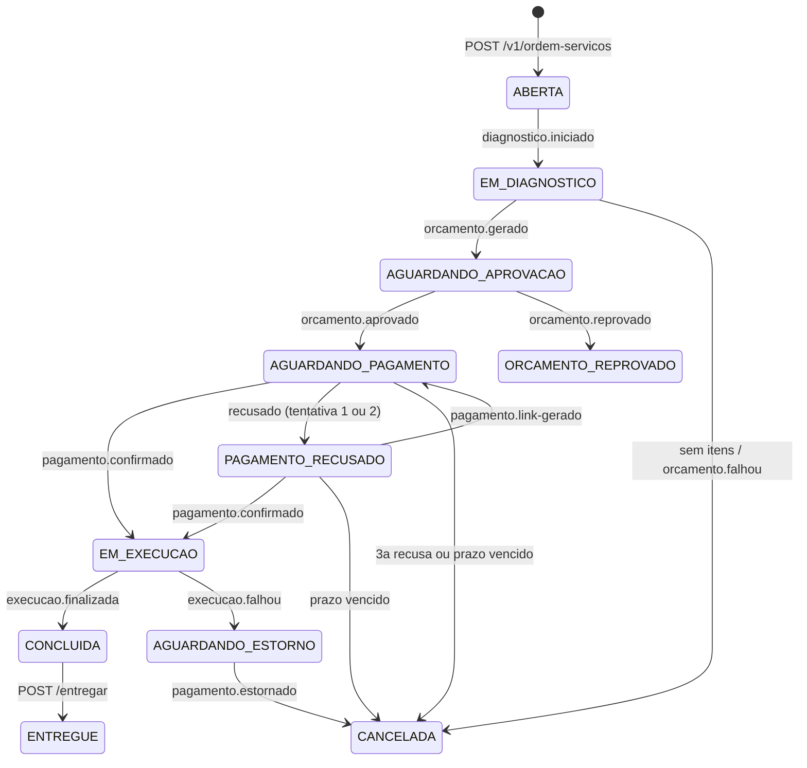

# Arquitetura do OS Service

Este documento resume o desenho. A tabela de transicoes esta implementada em
`domain/saga/MaquinaEstadosSaga.java`.

## Camadas

Arquitetura hexagonal, com os pacotes `domain` (OS, itens, maquina de estados), `application` (casos de uso e
portas), `adapter` (REST e Kafka de entrada) e `infrastructure` (JPA/MySQL, outbox, seguranca, configuracao).
O dominio nao conhece Spring. O Cadastro fica atras de `CadastroPort`, hoje com um stub (`cadastro.modo=stub`).

## Estados da OS

`ABERTA`, `EM_DIAGNOSTICO`, `AGUARDANDO_APROVACAO`, `AGUARDANDO_PAGAMENTO`, `PAGAMENTO_RECUSADO`,
`EM_EXECUCAO`, `AGUARDANDO_ESTORNO`, `CONCLUIDA`, `ENTREGUE`, `ORCAMENTO_REPROVADO`, `CANCELADA`.
Finais: `ENTREGUE`, `ORCAMENTO_REPROVADO`, `CANCELADA`.

Alem disso, `POST /{id}/cancelar` cancela qualquer OS antes de `EM_EXECUCAO`.

## Compensacoes

- **Execucao falha depois do pagamento:** vai para `AGUARDANDO_ESTORNO` e envia `billing.estornar-pagamento`. So vira
  `CANCELADA` depois de `pagamento.estornado`.
- **Pagamento recusado:** ate 3 tentativas no total. Cada recusa (1 e 2) gera nova cobranca; a terceira cancela.
- **Link vencido:** um agendador (a cada 30 s) cancela as sagas com `prazo_pagamento` vencido. O prazo e
  `saga.pagamento.validade-minutos` (30 por padrao, 2 no perfil `demo`).
- **Pagamento atrasado** (confirmacao em OS ja cancelada) ou **segunda cobranca confirmada**: a OS nao muda e o servico
  manda estornar.
- **Estorno que falhou** (`pagamento.estorno-falhou`): a OS fica em `AGUARDANDO_ESTORNO`, com log, metrica e registro no historico;
  `POST /{id}/reprocessar-estorno` reenvia o comando.

## Confiabilidade

- **Outbox transacional:** a mudanca de status e a mensagem de saida sao gravadas na mesma transacao (tabela `outbox`).
  `PublicadorOutbox` envia ao Kafka e marca como enviada.
- **Consumidor idempotente:** o `eventId` vai para `mensagem_processada` na mesma transacao do processamento; repeticao
  e ignorada. Confirmacao repetida do mesmo `pagamentoId` tambem nao gera novo comando.
- **Ordem:** a chave Kafka e o `osId`; ha ordem por OS dentro de cada topico. Evento que nao combina com o status atual e
  descartado com log e metrica.
- **DLT:** erro tecnico tem 3 retentativas com intervalo exponencial (1 s, 2 s, 4 s) e depois a mensagem vai para
  `<topico>.dlt` (mesma particao) e incrementa a metrica. Mensagem malformada (JSON invalido ou campo obrigatorio
  ausente) nao e retentada e vai direto para a DLT.

## Limites aceitos

- **Uma replica:** o relay do outbox nao foi desenhado para varias instancias (`replicas: 1`).
- **Recreate:** o Deployment usa `strategy: Recreate`, entao ha indisponibilidade durante cada atualizacao.
- **DLT sem reprocessamento automatico:** a mensagem e reenviada manualmente com ferramentas do Kafka. Se um
  `pagamento.confirmado` cair na DLT, a OS pode ser cancelada pelo prazo; o reenvio aciona a regra de pagamento
  atrasado, que estorna.
- **Estornos simultaneos:** ha uma unica vaga de estorno pendente. Um segundo estorno simultaneo gera so alerta; o comando
  sai, mas a vaga do primeiro nao e sobrescrita, e a API `reprocessar-estorno` nao o reprocessa.
- **Cadastro em stub:** qualquer `clienteId` e `veiculoId` e aceito.
